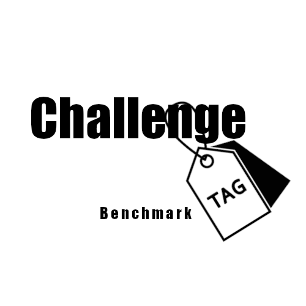

### Codabench bundle: Challenge Tagger

Layout:

- `competition.yaml`           — written by write_competition_yaml
- `pages/`                     — markdown pages referenced from competition.yaml
- `ingestion_program/`         — ingestion.py + metadata.yaml: trains the model and predicts
- `scoring_program/`           — score.py + metadata.yaml: scores the predictions
- `feedback_phase/`, `final_phase/` — per phase: `input_data/` (train data + labels, valid or test data) and `reference_data/` (valid or test labels)
- `starting_kit/`              — files for participants to download
- `public_data/`               — (optional) publicly downloadable data

Data:

- `data/input_data.csv`, `data/reference_data.csv` — full labeled dataset (3874 deduplicated samples)
- `data/split_data.py` — shuffles it into train (2326) / valid (774) / test (774), checks every label is present in each set, and writes the phase folders of the bundle
